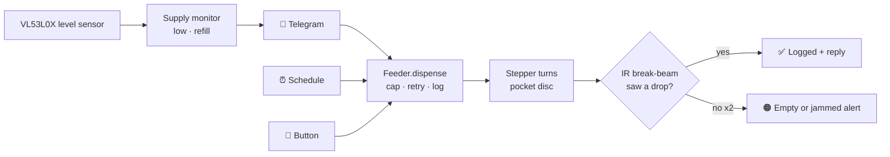

<!-- Based on https://github.com/othneildrew/Best-README-Template -->
<a id="readme-top"></a>

<!-- PROJECT SHIELDS -->
[![Contributors][contributors-shield]][contributors-url]
[![Forks][forks-shield]][forks-url]
[![Stargazers][stars-shield]][stars-url]
[![Issues][issues-shield]][issues-url]
[![MIT License][license-shield]][license-url]
![Status][status-shield]


<!-- PROJECT LOGO -->
<br />
<div align="center">
  <a href="https://github.com/rutvijdhotey/pet-treat-feeder">
    
  </a>

  <h3 align="center">Pet Treat Feeder</h3>

  <p align="center">
    A Raspberry Pi 3 cat treat dispenser you control from Telegram: one treat at a time, a daily cap, and alerts when supply runs low. The body is 3D printed.
    <br />
    <a href="docs/PRD.md"><strong>Read the PRD »</strong></a>
    <br />
    <br />
    <a href="docs/IMPLEMENTATION_PLAN.md">Implementation Plan</a>
    &middot;
    <a href="https://github.com/rutvijdhotey/pet-treat-feeder/issues/new?labels=bug">Report Bug</a>
    &middot;
    <a href="https://github.com/rutvijdhotey/pet-treat-feeder/issues/new?labels=enhancement">Request Feature</a>
  </p>
</div>


<!-- TABLE OF CONTENTS -->
<details>
  <summary>Table of Contents</summary>
  <ol>
    <li>
      <a href="#about-the-project">About The Project</a>
      <ul>
        <li><a href="#features">Features</a></li>
        <li><a href="#how-it-works">How It Works</a></li>
        <li><a href="#built-with">Built With</a></li>
      </ul>
    </li>
    <li>
      <a href="#getting-started">Getting Started</a>
      <ul>
        <li><a href="#prerequisites">Prerequisites</a></li>
        <li><a href="#hardware">Hardware</a></li>
        <li><a href="#installation">Installation</a></li>
      </ul>
    </li>
    <li><a href="#usage">Usage</a></li>
    <li><a href="#roadmap">Roadmap</a></li>
    <li><a href="#project-structure">Project Structure</a></li>
    <li><a href="#contributing">Contributing</a></li>
    <li><a href="#license">License</a></li>
    <li><a href="#contact">Contact</a></li>
    <li><a href="#acknowledgments">Acknowledgments</a></li>
  </ol>
</details>


<!-- ABOUT THE PROJECT -->
## About The Project

> 🚧 **Status: design phase.** The PRD, plan, wiring and BOM are done, and the build is tracked on the [project board][project-url]. The install steps below describe the planned v1 setup.

Off-the-shelf treat dispensers tend to be expensive or tied to a cloud account, or they drop a random handful of treats each time. This project is a small, freestanding feeder for **one small cat** that:

* drops **exactly one** kibble-sized treat per request, and **confirms** it fell
* never gives more than **8 treats a day**, however the treats are requested
* tells you when it's **running low**, **jammed** or **offline**, without spamming your phone
* is cheap to build: about $50 of parts plus a hobby 3D printer

<p align="right">(<a href="#readme-top">back to top</a>)</p>


### Features

**Must-haves (v1)**

| | Feature |
|---|---|
| 🐟 | Dispense one treat on demand (Telegram or the button on the device) or on a daily schedule |
| 🛑 | Daily cap of 8, shared by every trigger |
| 📉 | Hopper level as a %, a low-supply alert at 20% or below, and automatic refill detection |
| 🧾 | Last treat, today's count, and every time with its source |
| 💡 | Three front LEDs: **power**, **connected**, **supply** |
| 🔘 | Safe power button and a manual treat button |
| 🐈 | Cat-proof body: weighted base, twist-lock lid, paw-proof chute |
| 🔒 | Telegram allow-list. Strangers get no response. |

**Aspirational:** cat calls through a Google Nest speaker · swappable discs for different treats · "Hey Google" via Matter · multiple cats · a local web dashboard.

<p align="right">(<a href="#readme-top">back to top</a>)</p>


### How It Works



A **rotating pocket disc** sits under a 150 mL hopper. Each pocket is sized to hold exactly one treat. Every step of the stepper motor carries one full pocket to the exit hole while an empty pocket refills under the hopper by gravity. An **IR break-beam** in the chute confirms each drop. A **time-of-flight sensor** in the lid measures how full the hopper is.

<p align="right">(<a href="#readme-top">back to top</a>)</p>


### Built With

* [![Raspberry Pi][RaspberryPi-badge]][RaspberryPi-url]
* [![Python][Python-badge]][Python-url]
* [![Telegram][Telegram-badge]][Telegram-url]
* [![SQLite][SQLite-badge]][SQLite-url]
* [![OpenSCAD][OpenSCAD-badge]][OpenSCAD-url]
* [![GitHub Actions][Actions-badge]][Actions-url]

Key libraries: `python-telegram-bot`, `gpiozero` + `lgpio`, `APScheduler`, `adafruit-circuitpython-vl53l0x`, `pytest`.

<p align="right">(<a href="#readme-top">back to top</a>)</p>


<!-- GETTING STARTED -->
## Getting Started

### Prerequisites

* Raspberry Pi 3 (B or B+) running **Raspberry Pi OS Lite 64-bit (Bookworm)**
* A 5 V **2.5 A or higher** micro-USB power supply
* Python 3.11
* A Telegram bot token from [@BotFather](https://t.me/BotFather) and your Telegram user ID
* Access to any hobby FDM printer (0.4 mm nozzle, PLA + PETG)

### Hardware

| | |
|---|---|
| 🧾 Parts list | [`docs/BOM.md`](docs/BOM.md): about $50 in new parts |
| 🔌 Wiring and pin map | [`docs/WIRING.md`](docs/WIRING.md) |
| 🖨️ Printed parts | `hardware/cad/` (OpenSCAD source) → `hardware/stl/` (exports) |

The build runs **breadboard first, then a soldered HAT**. Nothing gets soldered until the breadboard build passes a 48-hour soak test.

### Installation

_Planned v1 flow (lands in milestone M1)._

1. Clone the repo onto the Pi
   ```sh
   git clone https://github.com/rutvijdhotey/pet-treat-feeder.git
   cd pet-treat-feeder
   ```
2. Add your secrets and settings
   ```sh
   cp .env.example .env                    # add TELEGRAM_BOT_TOKEN
   cp config.example.yaml config.yaml      # add your Telegram user ID, time zone
   ```
3. Enable the GPIO overlays in `/boot/firmware/config.txt` (see [WIRING.md](docs/WIRING.md#bootfirmwareconfigtxt)) and reboot
4. Install and start the service
   ```sh
   sudo ./deploy/install.sh
   systemctl status pet-treat-feeder
   ```

**Developing on a Mac:** the hardware layer has fakes, so everything except the physical motor and sensors runs locally:
```sh
pip install -e ".[dev]"
pytest
FEEDER_HARDWARE=fake python -m feeder
```

<p align="right">(<a href="#readme-top">back to top</a>)</p>


<!-- USAGE EXAMPLES -->
## Usage

| Telegram command | What it does |
|---|---|
| `/treat` or 🐟 | Dispense one treat → `Treat dispensed ✅ (3/8 today)` |
| `/status` | Hopper %, treats and days left, last treat, uptime |
| `/today` | `4/8 · 08:00 ⏰ · 12:31 📱 · 15:02 🔘 · 18:00 ⏰` |
| `/last` | Time and source of the last treat |
| `/schedule add 08:00 [n]` | Add a daily slot (n treats, default 1) |
| `/schedule list` · `remove <id>` | Manage slots |

**Front panel**

| LED | Solid | Blinking | Off |
|---|---|---|---|
| 🟢 Power | Running | Booting / shutting down | Safe to unplug |
| 🔵 Connected | Online | Reconnecting | Offline |
| 🟠 Supply | 20% or below | Empty or jammed | OK |

Push notifications 🔔 cover only things that need you: low supply, jams, the device coming back online, and skipped schedules. Everything else arrives silently 🔕, including a 21:00 daily summary.

_Full spec: [PRD §3.7](docs/PRD.md#37-telegram-interface)._

<p align="right">(<a href="#readme-top">back to top</a>)</p>


<!-- ROADMAP -->
## Roadmap

- [ ] **M0: Setup and ordering** (Nov 16): parts ordered, Pi flashed, CI running
- [ ] **M1: Core software on fakes** (Nov 30): dispense, cap, supply, scheduler, Telegram
- [ ] **M2: Breadboard prototype and test rig** (Dec 7): real hardware, pocket-disc tuning, 48 h soak test
- [ ] **M3: Enclosure v1** (Dec 21): OpenSCAD models, printed and test-fitted
- [ ] **M4: Integration and soldered HAT** (Jan 4): final build, 1-week burn-in with the cat
- [ ] **M5: Aspirational**
    - [ ] Cat calls via Google Nest speaker
    - [ ] Swappable discs for different treats
    - [ ] "Hey Google" voice trigger (Matter)
    - [ ] Multiple cats
    - [ ] Local web dashboard

The [project board][project-url] and [open issues][issues-url] have the full task list.

<p align="right">(<a href="#readme-top">back to top</a>)</p>


<!-- PROJECT STRUCTURE -->
## Project Structure

```
pet-treat-feeder/
├── docs/            PRD, implementation plan, BOM, wiring
├── src/feeder/      Python service (core · hardware · adapters · storage)
├── tests/           pytest suite (runs on fakes, no Pi needed)
├── hardware/
│   ├── cad/         OpenSCAD parametric models
│   └── stl/         Exported printable parts
├── deploy/          systemd unit + install script
└── images/          Logo, photos, screenshots
```

<p align="right">(<a href="#readme-top">back to top</a>)</p>


<!-- CONTRIBUTING -->
## Contributing

This is a personal project, but ideas and fixes are welcome. Treat-shape profiles for the pocket disc are especially useful.

1. Fork the project
2. Create your feature branch (`git checkout -b feature/AmazingFeature`)
3. Commit your changes (`git commit -m 'Add some AmazingFeature'`)
4. Push to the branch (`git push origin feature/AmazingFeature`)
5. Open a pull request

Please add tests for core logic changes. CI must stay green.

### Top contributors:

<a href="https://github.com/rutvijdhotey/pet-treat-feeder/graphs/contributors">
  
</a>

<p align="right">(<a href="#readme-top">back to top</a>)</p>


<!-- LICENSE -->
## License

Distributed under the MIT License. See [`LICENSE`](LICENSE) for more information.

<p align="right">(<a href="#readme-top">back to top</a>)</p>


<!-- CONTACT -->
## Contact

Rutvij Dhotey: [@rutvijdhotey](https://github.com/rutvijdhotey)

Project Link: [https://github.com/rutvijdhotey/pet-treat-feeder](https://github.com/rutvijdhotey/pet-treat-feeder)

<p align="right">(<a href="#readme-top">back to top</a>)</p>


<!-- ACKNOWLEDGMENTS -->
## Acknowledgments

* [Best-README-Template](https://github.com/othneildrew/Best-README-Template)
* [gpiozero](https://gpiozero.readthedocs.io/)
* [python-telegram-bot](https://python-telegram-bot.org/)
* [Adafruit CircuitPython VL53L0X](https://github.com/adafruit/Adafruit_CircuitPython_VL53L0X)
* [OpenSCAD](https://openscad.org/)
* [Img Shields](https://shields.io)
* The cat, for quality assurance 🐈

<p align="right">(<a href="#readme-top">back to top</a>)</p>


<!-- MARKDOWN LINKS & IMAGES -->
[contributors-shield]: https://img.shields.io/github/contributors/rutvijdhotey/pet-treat-feeder.svg?style=for-the-badge
[contributors-url]: https://github.com/rutvijdhotey/pet-treat-feeder/graphs/contributors
[forks-shield]: https://img.shields.io/github/forks/rutvijdhotey/pet-treat-feeder.svg?style=for-the-badge
[forks-url]: https://github.com/rutvijdhotey/pet-treat-feeder/network/members
[stars-shield]: https://img.shields.io/github/stars/rutvijdhotey/pet-treat-feeder.svg?style=for-the-badge
[stars-url]: https://github.com/rutvijdhotey/pet-treat-feeder/stargazers
[issues-shield]: https://img.shields.io/github/issues/rutvijdhotey/pet-treat-feeder.svg?style=for-the-badge
[issues-url]: https://github.com/rutvijdhotey/pet-treat-feeder/issues
[license-shield]: https://img.shields.io/github/license/rutvijdhotey/pet-treat-feeder.svg?style=for-the-badge
[license-url]: https://github.com/rutvijdhotey/pet-treat-feeder/blob/main/LICENSE
[status-shield]: https://img.shields.io/badge/status-design%20phase-orange?style=for-the-badge
[project-url]: https://github.com/users/rutvijdhotey/projects/5
[RaspberryPi-badge]: https://img.shields.io/badge/Raspberry%20Pi%203-A22846?style=for-the-badge&logo=raspberrypi&logoColor=white
[RaspberryPi-url]: https://www.raspberrypi.com/
[Python-badge]: https://img.shields.io/badge/Python%203.11-3776AB?style=for-the-badge&logo=python&logoColor=white
[Python-url]: https://www.python.org/
[Telegram-badge]: https://img.shields.io/badge/Telegram%20Bot-26A5E4?style=for-the-badge&logo=telegram&logoColor=white
[Telegram-url]: https://core.telegram.org/bots
[SQLite-badge]: https://img.shields.io/badge/SQLite-003B57?style=for-the-badge&logo=sqlite&logoColor=white
[SQLite-url]: https://www.sqlite.org/
[OpenSCAD-badge]: https://img.shields.io/badge/OpenSCAD-F9D72C?style=for-the-badge&logo=openscad&logoColor=black
[OpenSCAD-url]: https://openscad.org/
[Actions-badge]: https://img.shields.io/badge/GitHub%20Actions-2088FF?style=for-the-badge&logo=githubactions&logoColor=white
[Actions-url]: https://github.com/features/actions
