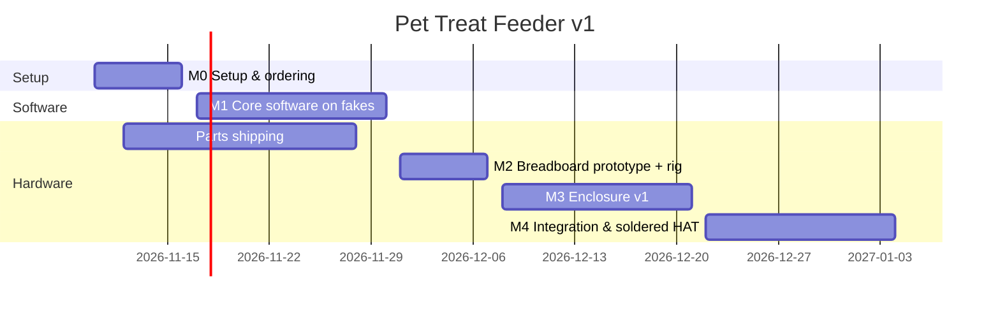

# Implementation Plan

**Pace:** ~4–6 h/week · **Start:** 2026-11-10 · **v1 target:** 2027-01-04

Every task below is a GitHub issue on the project board, grouped by milestone. Software milestone M1 runs *before* the hardware milestones on purpose — parts take 1–2 weeks to ship, so development never waits on deliveries.

## Working agreements

- **Tests first** for core logic (cap, dispense, supply, scheduler): write the failing test, then the code.
- `main` is always green in CI; work on short feature branches → PR → merge.
- **Soak-test gate:** nothing is soldered until the breadboard build passes the 48 h soak test (#M2-8).
- Issue size: **S** ≤ 1 h · **M** 1–3 h · **L** 3–6 h.

---

## M0 — Setup & ordering · due 2026-11-16

| # | Task | Area | Size |
|---|---|---|---|
| M0-1 | Order all must-have parts (one `purchase` issue per [BOM](BOM.md) line) | Electronics | S |
| M0-2 | Verify power adapter is 5 V ≥ 2.5 A; order 3 A supply if not | Electronics | S |
| M0-3 | Measure 10 treats (diameter + height, min/max/avg) and record in `docs/treats.md` | 3D print | S |
| M0-4 | Flash Raspberry Pi OS Lite 64-bit; hostname `treatfeeder`, SSH keys only, Wi-Fi, timezone, unattended-upgrades | Software | M |
| M0-5 | Create Telegram bot with BotFather; get your user ID; store token in `.env` on the Pi | Software | S |
| M0-6 | Python project scaffold: `pyproject.toml`, `src/` layout, ruff, pytest, pre-commit | Software | M |
| M0-7 | GitHub Actions CI: lint + tests on push/PR | Software | S |

## M1 — Core software on fakes · due 2026-11-30

All of M1 runs on a Mac against `hardware/fake.py` — no Pi required.

| # | Task | Area | Size |
|---|---|---|---|
| M1-1 | HAL interfaces (`Motor`, `DropSensor`, `LevelSensor`, `StatusLeds`, `Buttons`) + fake implementations | Software | M |
| M1-2 | Config loading: `.env` + `config.yaml` with validation; `config.example.yaml` | Software | S |
| M1-3 | SQLite storage: schema, migrations, event/schedule/settings queries (WAL mode) | Software | M |
| M1-4 | Daily cap policy: cap of 8, local-TZ day boundary, shared across sources (TDD) | Software | S |
| M1-5 | `Feeder.dispense(source)`: pocket rotation, drop confirm, one retry, empty/jam state, lock, logging (TDD) | Software | L |
| M1-6 | Supply monitor: distance → %, ≤ 20% low alert with hysteresis, auto refill detection with debounce (TDD) | Software | L |
| M1-7 | Clock guard: NTP-synced / RTC check, blocks scheduled dispenses (TDD) | Software | S |
| M1-8 | Scheduler: daily slots from DB, count per slot, no catch-up, skip-on-cap + alert, optional jitter (TDD) | Software | M |
| M1-9 | Status LED state machine (power / connected / supply, PWM brightness) | Software | M |
| M1-10 | Telegram bot: allow-list, `/start /help /treat /status /today /last /schedule`, inline buttons | Software | L |
| M1-11 | Notifier: push vs silent routing, offline queue, back-online message, 21:00 daily summary | Software | M |
| M1-12 | `app.py` wiring + logging; run end-to-end on the Mac with fakes against the real Telegram bot | Software | M |
| M1-13 | `deploy/`: systemd unit, install script, `make deploy` (rsync + restart over SSH) | Software | M |

## M2 — Breadboard prototype & test rig · due 2026-12-07

| # | Task | Area | Size |
|---|---|---|---|
| M2-1 | `config.txt` overlays: hardware I2C off, `gpio-shutdown` on GPIO 3, `i2c-gpio` bus 3 on GPIO 23/24 | Electronics | S |
| M2-2 | Breadboard wiring per [WIRING.md](WIRING.md) via T-cobbler; photo in docs | Electronics | M |
| M2-3 | Pi HAL: stepper half-step driver (ULN2003), de-energise after move | Software | M |
| M2-4 | Pi HAL: break-beam drop sensor, LEDs (PWM), treat button | Software | M |
| M2-5 | Pi HAL: VL53L0X on bus 3 + calibration script (`empty_mm`, `full_mm`) | Software | M |
| M2-6 | OpenSCAD test rig (pocket disc + dispense plate + short hopper ring) — print in PETG | 3D print | L |
| M2-7 | Tune pocket size/clearance with real treats until 1 pocket = 1 treat ≥ 98% over 100 turns | 3D print | M |
| M2-8 | **Soak-test gate:** 48 h on breadboard, ≥ 50 dispenses, < 2% miss/jam, 0 reboots, cap never exceeded | Software | M |

## M3 — Enclosure v1 · due 2026-12-21

| # | Task | Area | Size |
|---|---|---|---|
| M3-1 | OpenSCAD library: `params.scad` (treat dims, clearances, print constraints), shared helpers | 3D print | M |
| M3-2 | Hopper (~150 mL, ≥ 60° funnel, wiper lip) + twist-lock lid with VL53L0X mount | 3D print | L |
| M3-3 | Chute with baffle + break-beam holes, front treat tray | 3D print | M |
| M3-4 | Base / electronics bay: Pi + HAT standoffs, weight pocket, feet recesses, front panel (3 LEDs, 2 buttons), wall-mount holes | 3D print | L |
| M3-5 | Back panel: vents, cable strain relief | 3D print | S |
| M3-6 | Export STLs + `hardware/PRINTING.md` (material, orientation, settings per part) for your friend | Docs | S |
| M3-7 | Print and test-fit full enclosure; record fixes | 3D print | L |

## M4 — Integration & soldered HAT · due 2027-01-04

| # | Task | Area | Size |
|---|---|---|---|
| M4-1 | Solder proto HAT with JST-XH connectors per pin map (**blocked by M2-8**) | Electronics | L |
| M4-2 | Final assembly, cable management, braided sleeve, weight + feet | Electronics | M |
| M4-3 | 1-week burn-in with the cat; triage and fix issues | Software | L |
| M4-4 | Assembly guide + photos; update README screenshots | Docs | M |
| M4-5 | Tag `v1.0.0` release with STLs attached | Docs | S |

## M5 — Aspirational · no due date

| # | Task | Area | Size |
|---|---|---|---|
| M5-1 | Cat calls + low-supply announcements cast to Google Nest speaker (`pychromecast`) | Software | M |
| M5-2 | Treat profiles + swappable discs for different treat types | 3D print | M |
| M5-3 | "Hey Google" voice trigger via Matter on/off device | Software | L |
| M5-4 | Multi-cat support (per-cat caps/history; identification approach TBD) | Software | L |
| M5-5 | Local read-only web dashboard | Software | M |
| M5-6 | Days-of-week schedules | Software | S |
| M5-7 | DS3231 RTC: buy, wire on bus 3, enable overlay | Electronics | S |
