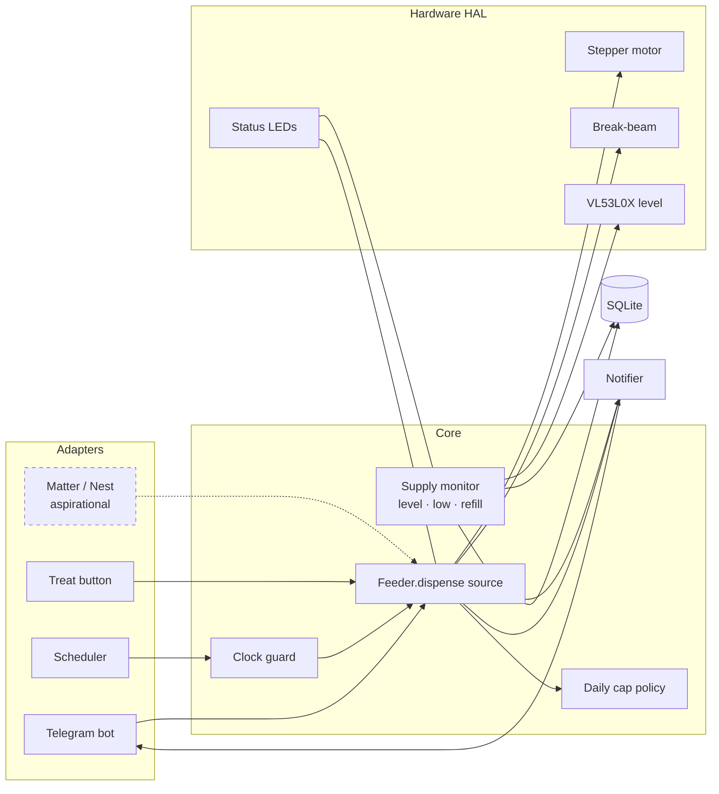

# Product Requirements Document — Pet Treat Feeder

| | |
|---|---|
| **Owner** | Rutvij Dhotey |
| **Status** | Approved for build (design phase) |
| **Last updated** | 2026-11-10 |
| **Platform** | Raspberry Pi 3 (B or B+) |

---

## 1. Overview

A small, freestanding, 3D-printed treat dispenser for one small cat. It drops **one kibble-sized treat at a time**, either on demand (Telegram message or a button on the device) or on a recurring daily schedule. It enforces a **daily cap of 8 treats**, knows how full its hopper is, detects refills on its own, and tells you when supply is low, when it is jammed, and whether it is online.

### 1.1 Goals

1. Reliably dispense exactly one treat per request, and *confirm* that it fell.
2. Never exceed the daily cap of 8, regardless of how treats are requested.
3. Keep the owner informed (supply, connectivity, history) without being noisy.
4. Be cheap and generic to build: hobby-grade 3D printer, common parts, ~$55–65 in new parts.

### 1.2 Non-goals (v1)

- Soft, sticky, or irregular biscuit treats.
- Meal feeding (this is a treat dispenser, not a food bowl).
- Camera / video.
- A custom phone app or cloud backend.
- Multiple pets (aspirational).

### 1.3 Users

| User | Needs |
|---|---|
| **Owner** (Rutvij) | Treat the cat remotely, set schedules, see history, get alerts. |
| **Allow-listed household members** | Same as owner (added via config). |
| **The cat** | Gets treats. Will try to knock it over, paw the chute and open the lid. |

---

## 2. Features

### 2.1 Must-haves (v1)

#### Physical

| ID | Requirement | Acceptance criteria |
|---|---|---|
| P1 | **Dispense one treat** (kibble-sized, ~8–15 mm) | One rotation step of the pocket disc drops one piece ≥ 98% of the time in the soak test; the IR break-beam confirms each drop. |
| P2 | **Low-supply indicator** | Amber LED solid when hopper ≤ 20%; blinking when empty/jammed; off otherwise. |
| P3 | **Connected / disconnected indicator** | Blue LED solid when Wi-Fi + Telegram reachable; blinking while reconnecting; off when offline. |
| P4 | **On / off indicator** | Green LED solid while feeder software is running; blinking while booting/shutting down; off = safe to unplug. |
| P5 | **Safe power button** | Press → clean shutdown; press again → boot. No SD-card corruption from pulling power. |
| P6 | **Manual treat button** | Dispenses one treat locally, counts toward daily cap, works without internet. |
| P7 | **Cat-proof body** | Freestanding weighted base with non-slip feet; twist-lock lid; paw-proof baffled chute into a front tray; enclosed electronics. |
| P8 | **Hopper ~150 mL** | Holds ~80 small treats (~10 days at the cap). |

#### Software

| ID | Requirement | Acceptance criteria |
|---|---|---|
| S1 | **On-demand trigger** via Telegram (`/treat` or 🐟 button) | Reply within 5 s: "Treat dispensed ✅ (3/8 today)" or a reason it couldn't (cap / empty / jam). |
| S2 | **Recurring timed trigger** | Daily schedules managed from Telegram (`/schedule add 08:00 [count]`, `list`, `remove`). |
| S3 | **Daily cap = 8** (configurable) | Shared across schedule, Telegram and button. Requests over the cap are refused and reported. |
| S4 | **Low-supply details** | `/status` shows hopper %, est. treats left, est. days left. Push alert once when crossing ≤ 20%. |
| S5 | **Auto refill detection** | Level rise ≥ 15 pts, stable across 2 readings ~30 s apart → refill event, alert re-armed, silent "Refill detected" message. No manual `/refilled` command. |
| S6 | **Last dispensed treat** | `/last` shows time + source. |
| S7 | **Today's history** | `/today` shows count/cap and each time with its source (⏰ schedule, 📱 Telegram, 🔘 button). |
| S8 | **Access control** | Only Telegram user IDs in the allow-list can use the bot; others get no reply and are logged. |
| S9 | **Alerts** | Push: low supply, empty/jam, back online (with downtime), scheduled treat skipped. Silent: scheduled dispense, button dispense, 21:00 daily summary. |
| S10 | **Jam / empty detection** | Two consecutive pockets with no drop detected → stop, amber blink, alert. Failed attempts don't count toward the cap. |
| S11 | **Clock safety** | Scheduled dispenses are blocked until the system clock is synced (NTP or RTC). On-demand still works. |

### 2.2 Aspirational (post-v1, in priority order)

| ID | Feature | Notes |
|---|---|---|
| A1 | **Cat calls & announcements through Google Nest speaker** | Cast an audio clip ("pspsps", bag shake) or a TTS "Treats are running low" via `pychromecast`. No extra hardware. |
| A2 | **Different kinds of treats** | Swappable pocket discs printed from the same parametric model (`treat_diameter`, `treat_height`); a "treat profile" setting in software. |
| A3 | **"Hey Google, turn on Treat Feeder"** | Pi exposes a Matter on/off device; turning it on dispenses one treat and auto-resets. Local, free. |
| A4 | **Multiple cats** | Per-cat caps and history; needs a way to identify the cat (e.g. separate trays, RFID collar tag, or camera). |
| A5 | **Local web dashboard** | Read-only history/status page on the LAN. |
| A6 | **Days-of-week schedules** and random jitter | Jitter (±5 min) is designed in but off by default. |
| A7 | **DS3231 RTC module** | Keeps time across power cuts without internet. Optional in BOM. |

---

## 3. Design — Software

### 3.1 Stack

| Layer | Choice |
|---|---|
| OS | Raspberry Pi OS Lite **64-bit** (Bookworm), headless |
| Language | Python 3.11 |
| Process model | One `asyncio` service, managed by `systemd` (start on boot, restart on crash) |
| Telegram | `python-telegram-bot` (async, long polling — outbound only, no port forwarding) |
| GPIO | `gpiozero` with `lgpio` backend |
| Level sensor | `adafruit-circuitpython-vl53l0x` + `adafruit-extended-bus` (non-default I2C bus) |
| Scheduling | `APScheduler` |
| Storage | SQLite (single file, `/var/lib/pet-treat-feeder/feeder.db`) |
| Tests / CI | `pytest`, `ruff`, GitHub Actions |

### 3.2 Architecture



**Key principle:** every way of requesting a treat is a thin adapter calling one function, `Feeder.dispense(source)`. The cap, drop confirmation, jam handling and logging live there, once.

**Hardware Abstraction Layer (HAL):** `Motor`, `DropSensor`, `LevelSensor`, `StatusLeds`, `Buttons` are interfaces with two implementations — `hardware/pi.py` (real GPIO) and `hardware/fake.py` (in-memory, scriptable). All core logic is developed and tested on a Mac against the fakes.

### 3.3 Module layout

```
src/feeder/
  app.py               # wiring + asyncio main
  config.py            # .env + config.yaml loading/validation
  core/
    feeder.py          # Feeder.dispense(source)
    policy.py          # daily cap, day boundary in local TZ
    supply.py          # level → %, low alert w/ hysteresis, refill detection
    clock.py           # "is time trustworthy?" (NTP synced or RTC present)
  hardware/
    base.py            # HAL interfaces
    pi.py              # real implementations
    fake.py            # test/dev implementations
  adapters/
    telegram_bot.py    # commands, inline buttons, allow-list
    scheduler.py       # APScheduler jobs from DB schedules
    buttons.py         # treat button → dispense
    leds.py            # LED state machine
  notify.py            # push vs silent messages, daily summary
  storage/
    db.py              # SQLite schema + queries
```

### 3.4 Dispense algorithm

1. Reject if `treats_today >= daily_cap` → reply "Daily limit reached (8/8)".
2. Reject if in `EMPTY_OR_JAMMED` state (cleared by a refill or a successful manual retry).
3. Arm the break-beam counter, rotate the disc **one pocket pitch**, then wait up to 1.5 s for a drop.
4. Drop seen → log `dispense` event (`source`, `treats=<drops counted>`), de-energise motor, reply.
5. No drop → rotate one more pocket (the agitator also stirs). Still nothing → set `EMPTY_OR_JAMMED`, amber LED blinks, push alert. Failed attempts are logged as `dispense_failed` and do **not** count toward the cap.

Motor coils are de-energised after every move (no heat, no hum). Dispenses are serialised with an `asyncio.Lock` so two requests can never overlap.

### 3.5 Supply monitoring

- Reading every **5 min** and **before each dispense**; median of 5 samples.
- `pct = clamp((empty_mm - distance_mm) / (empty_mm - full_mm))`; `empty_mm`/`full_mm` calibrated once in M2 and stored in config.
- Estimated treats left = `pct × capacity_treats` (default 80); days left from the 7-day average rate.
- **Low**: alert once when crossing ≤ 20%; re-armed only when level goes back ≥ 30% (hysteresis) or a refill is detected.
- **Refill**: rise ≥ 15 pts, confirmed by a second reading ~30 s later.

### 3.6 Scheduling rules

| Rule | Behaviour |
|---|---|
| Recurrence | Daily at fixed local times |
| Treats per slot | 1 default, configurable per slot |
| Cap | Shared with all sources; over-cap slots are skipped + push alert |
| Missed (powered off) | Skipped, never caught up |
| Day boundary | Midnight in configured time zone |
| Jitter | Optional ±N min per slot, off by default |
| Clock not synced | Scheduled slots skipped + alert; on-demand still allowed |

### 3.7 Telegram interface

| Command | Response |
|---|---|
| `/start`, `/help` | Command list + inline buttons [🐟 Treat] [📊 Status] [📅 Today] |
| `/treat` | Dispense result + count |
| `/status` | Hopper %, est. treats/days left, last treat, uptime, Wi-Fi signal |
| `/today` | `n/8` + list of times with source icons |
| `/last` | Time + source of last treat |
| `/schedule add HH:MM [count]` · `list` · `remove <id>` | Manage schedules |

| Event | Delivery |
|---|---|
| Low supply, empty/jam, back online, schedule skipped | 🔔 Push |
| Scheduled dispense, button dispense, refill detected, 21:00 summary | 🔕 Silent (`disable_notification=True`) |

### 3.8 Status LEDs

| LED | Solid | Blinking | Off |
|---|---|---|---|
| 🟢 Power (GPIO 12) | Service running | Booting / shutting down | Safe to unplug |
| 🔵 Connected (GPIO 20) | Last Telegram poll OK < 60 s ago | Reconnecting | Offline > 5 min |
| 🟠 Supply (GPIO 21) | ≤ 20% | Empty / jammed | OK |

Brightness is PWM-dimmed and configurable (night-friendly).

### 3.9 Data model (SQLite)

```sql
events(id INTEGER PK, ts_utc TEXT, type TEXT, source TEXT, treats INTEGER, detail TEXT)
  -- type: dispense | dispense_failed | refill | low_supply | jam | boot | shutdown
  --       | online | offline | cap_reached | schedule_skipped | unauthorized
  -- source: schedule | telegram | button | voice | system
schedules(id INTEGER PK, time_local TEXT, count INTEGER, jitter_min INTEGER, enabled INTEGER, created_by INTEGER)
level_readings(ts_utc TEXT, distance_mm INTEGER, pct REAL)   -- 30-day retention
settings(key TEXT PK, value TEXT)
```

### 3.10 Configuration & secrets

- `.env` (never committed): `TELEGRAM_BOT_TOKEN`.
- `config.yaml` (never committed; `config.example.yaml` is): allow-listed user IDs, time zone, daily cap, low threshold, summary time, LED brightness, calibration values, pin map overrides.

### 3.11 Security

- Outbound-only networking (Telegram long polling). No open ports besides SSH.
- SSH key auth only, password login disabled.
- Allow-list enforced before any command handler runs.
- Unattended security upgrades enabled on the Pi.

---

## 4. Design — Hardware

### 4.1 Electronics

| Function | Part | Interface |
|---|---|---|
| Controller | Raspberry Pi 3 B/B+ | — |
| Disc drive | 28BYJ-48 5 V stepper + ULN2003 driver | 4 GPIO |
| Drop confirmation | IR break-beam pair (3 mm/5 mm) across the chute | 1 GPIO (pull-up) |
| Hopper level | VL53L0X ToF sensor in the lid, pointing down | Software I2C bus (GPIO 23/24) |
| Indicators | 3 × 5 mm LEDs (green/blue/amber) + 330 Ω | 3 GPIO |
| Buttons | 2 × 12 mm momentary (power, treat) | GPIO 3 (wake), GPIO 26 |
| Clock (optional) | DS3231 RTC | Same software I2C bus |
| Power | 5 V ≥ 2.5 A (3 A preferred) micro-USB | — |

Why software I2C: **GPIO 3 is the only pin that can wake a halted Pi**, and it is also the hardware I2C clock. The power button keeps GPIO 3; the sensor moves to an `i2c-gpio` bus on GPIO 23/24 (one line in `config.txt`).

Full pin map and wiring: [`WIRING.md`](WIRING.md).

### 4.2 Assembly approach

1. **Breadboard prototype** (M2) with a T-cobbler and Dupont jumpers — no solder.
2. **Soak-test gate**: 48 h, ≥ 50 dispenses, < 2% misses/jams, zero reboots.
3. **Soldered proto HAT** (M4) with **JST-XH** plugs to every module, using the identical pin map.

### 4.3 Mechanism — rotating pocket disc

```
        ┌──────── hopper (≥60° walls, agitator arm on shaft) ────────┐
        │                                                              │
        └────────┐  wiper lip                                          │
                 ▼                                                     │
   ══[pocket]══[pocket]══[pocket]══[pocket]══  ← disc (8 pockets) turns one pitch per treat
   ════════════════════════════════════╗  ╔══  ← base plate, exit hole opposite hopper outlet
                                       ║  ║
                              break-beam ─╫─  ← confirms the drop
                                       ╚══╗
                                  baffle  ╚═══▶ tray (paw can't reach the disc)
```

- Pockets ≈ treat diameter + 1.5 mm, disc thickness ≈ treat height + 1 mm → exactly one treat per pocket.
- Pockets under the hopper refill by gravity; the wiper lip sweeps off anything riding on top.
- 8 pockets → 512 half-steps per pitch on the 28BYJ-48 (~4096 half-steps/rev).
- Exit hole is an elongated slot (± a few degrees) so small step errors don't matter.
- Agitator: a small arm on top of the disc hub stirs the hopper outlet to prevent bridging.

### 4.4 3D-printed parts

| # | Part | Material | Notes |
|---|---|---|---|
| 1 | Pocket disc | PETG | D-bore for 28BYJ-48 shaft; integrated agitator arm. Swappable per treat type. |
| 2 | Dispense plate (stator) | PETG | Disc cavity, exit slot, stepper mount underneath |
| 3 | Hopper (~150 mL) | PETG | ≥ 60° funnel, wiper lip, bayonet ring on top |
| 4 | Lid | PETG | Twist-lock bayonet; VL53L0X window + mount |
| 5 | Chute + baffle | PETG | Break-beam holes across the throat |
| 6 | Treat tray | PETG | Front, low, wide |
| 7 | Base / electronics bay | PLA | Pi + HAT standoffs, weight pocket, foot recesses, front panel (3 LEDs, 2 buttons), wall-mount holes |
| 8 | Back panel | PLA | Vents, cable strain relief |
| T | **Test rig** (disc + plate + short hopper ring) | PETG | Printed first in M2 to tune pocket size with real treats |

### 4.5 Print constraints (generic — any hobby printer)

| Constraint | Value |
|---|---|
| Max part size | 180 × 180 × 180 mm |
| Nozzle / layer | 0.4 mm / 0.2 mm |
| Supports | Avoided by design (parts print flat) |
| Clearance (moving / press-fit) | 0.3 mm |
| Walls | ≥ 3 perimeters (1.2 mm), 20% infill; 4 perimeters on disc |
| Food-contact parts | PETG (not truly food-safe — brief contact with dry treats only; wash, don't soak) |
| Fasteners | M3 screws into heat-set inserts; no glue |
| CAD | OpenSCAD, parametric (`hardware/cad/params.scad`), STLs exported to `hardware/stl/` |

### 4.6 Approximate envelope

~170 × 150 mm footprint, ~190 mm tall. Base is wider than tall with a weight pocket (washers / coins / sand bag) and silicone feet.

---

## 5. Risks & mitigations

| Risk | Mitigation |
|---|---|
| Treats bridge in the hopper | ≥ 60° walls, agitator arm, test rig with real treats before full print |
| Pocket fits 0 or 2 treats | Parametric disc; tune in M2 test rig; break-beam counts actual drops |
| Stepper skips under jam → misalignment | Low speed / high torque, elongated exit slot, back-off-and-retry; optional hall-sensor homing if needed |
| Weak power adapter → brown-outs | Verify ≥ 2.5 A before M2; budget a 3 A supply |
| No RTC → wrong-time schedules after outage | Clock guard blocks schedules until synced; optional DS3231 |
| SD card corruption | Safe power button; SQLite WAL mode; journald to volatile storage |
| Cat knocks it over / paws in | Weighted wide base, baffled chute, twist-lock lid, wall-mount option |
| Telegram API outage | Button still works; schedules run locally; events queued and sent on reconnect |

---

## 6. Success metrics

- ≥ 98% dispense success over the 48 h soak test and the 1-week burn-in.
- 0 cap violations (verified from the event log).
- Low-supply alert fires before the hopper is empty in 100% of burn-in cycles.
- Owner gets ≤ 3 push notifications/day in normal operation.

## 7. Open questions

| Question | Owner | Needed by |
|---|---|---|
| Exact treat brand + measured diameter/height (10 samples) | Rutvij | M2 test rig |
| Power adapter rating (≥ 2.5 A?) | Rutvij | M2 |
| Pi 3 B vs B+ (affects nothing functional; note for docs) | Rutvij | M0 |
| Cat's name (for bot messages 🐱) | Rutvij | M1 |

## 8. Related docs

- [Implementation plan](IMPLEMENTATION_PLAN.md)
- [Bill of materials](BOM.md)
- [Wiring & pin map](WIRING.md)
